# mcdmex

A modern, accessible and fully customizable app for subway navigation in Mexico City.

    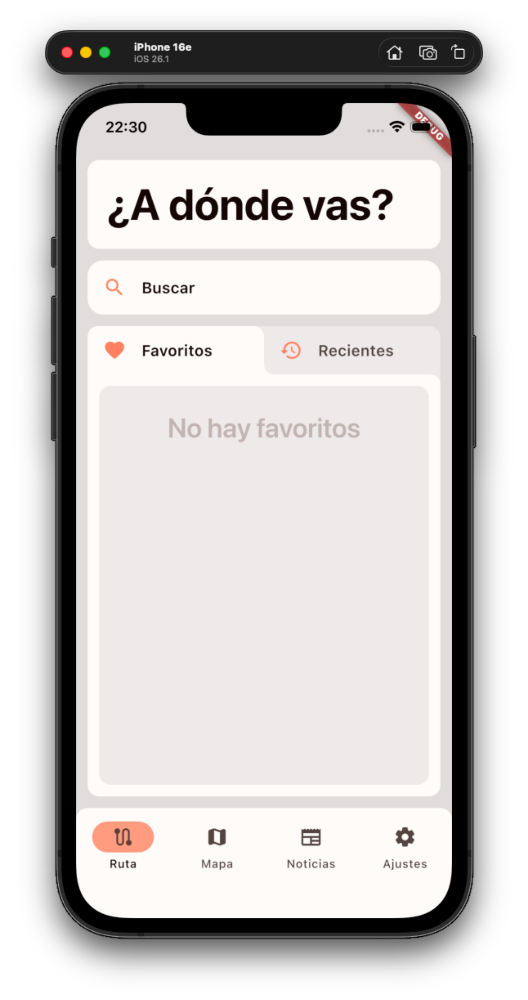
    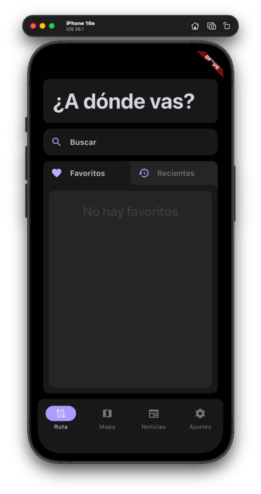

## Table of contents

- [Introduction](#introduction)
- [Features](#features)
- [App tour](#app-tour)
- [Download and installation](#download-and-installation)

## Introduction

`mcdmex` is a navigation app for the Mexico City Metro, built around an interactive map of the network's lines, stations and transfers.

It lets you check train arrival times and plan optimal routes between stations, choosing either the **fastest** option or the **most accessible** one. It also includes a news panel that keeps you informed about works, changes and other important notices.

Thanks to Flutter, the app runs on almost any platform.

    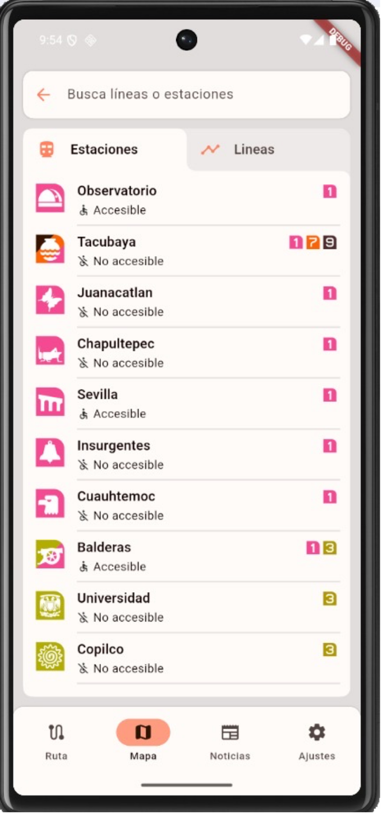
    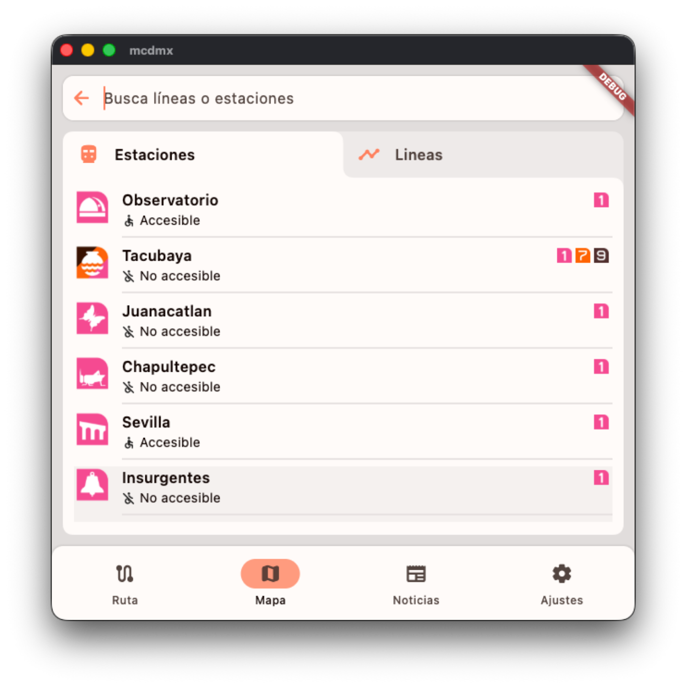

## Features

- **Interactive map** of the whole network, with every line and station.
- **Route planning** between any two stations, with step-by-step directions.
- **Two routing modes:** fastest route or most accessible route.
- **Arrival times** for every line and direction at each station.
- **Search** for lines and stations.
- **Favorites and recents** for the routes you use most.
- **News and notices** about works and service changes.
- **Customization:** light and dark themes, text size, tone and more.

## App tour

### Home and favorites

The home screen is where you can start a trip. Search for a destination, or simply select a route saved in **Favorites** or used recently in **Recents**.

    
    
    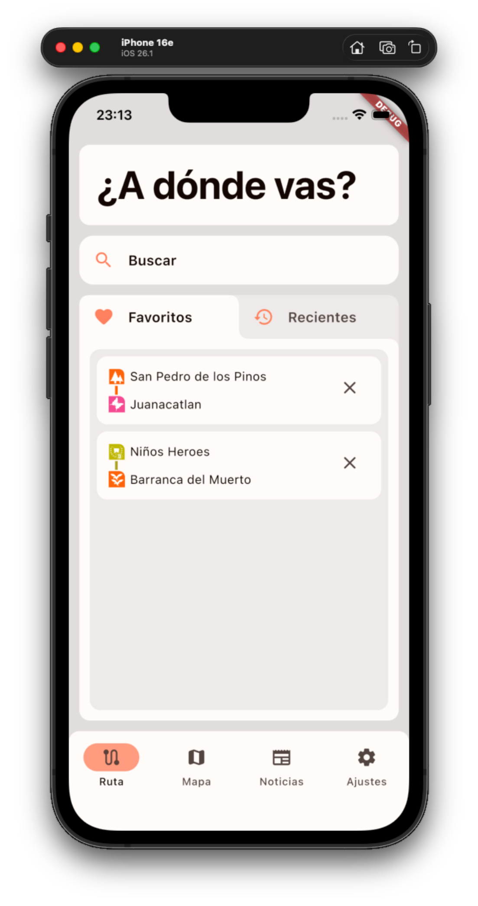

### Route planning

You can plan a route either by searching for a station or selecting it directly on the map. The estimated travel time is always shown, and any route can be saved to your favorites.

    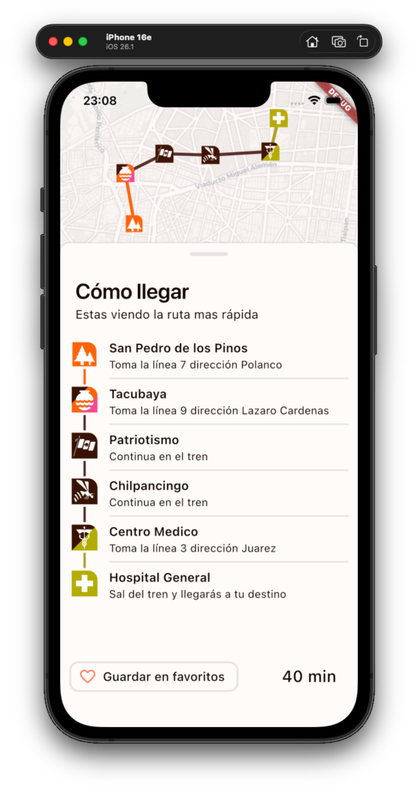
    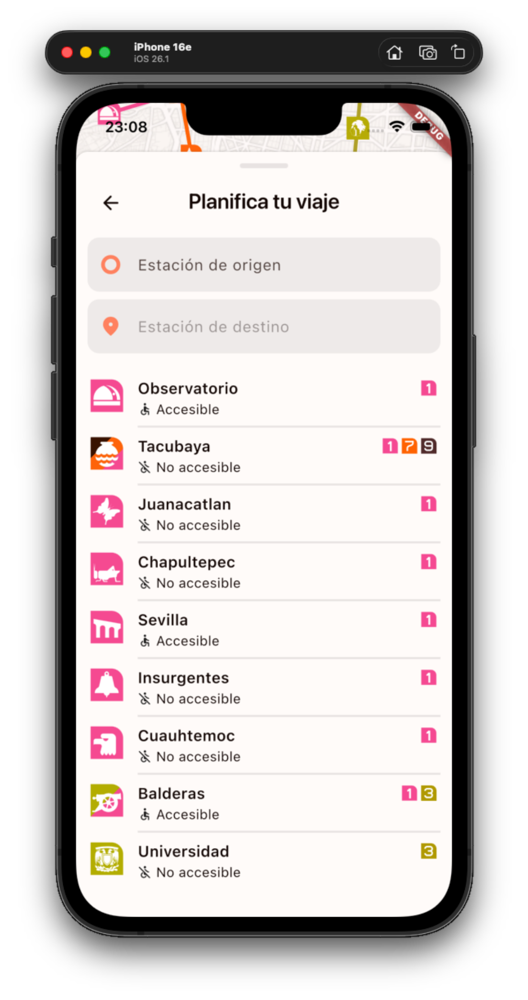
    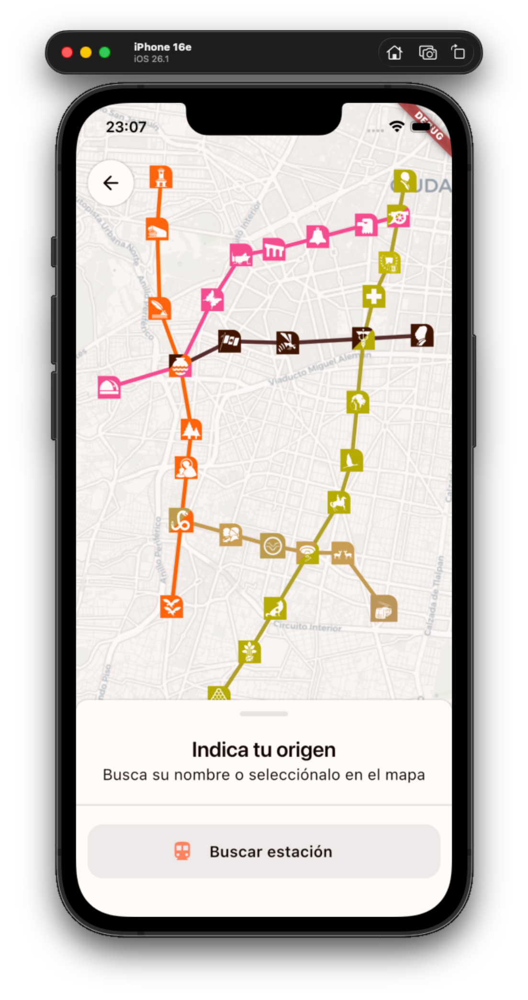
    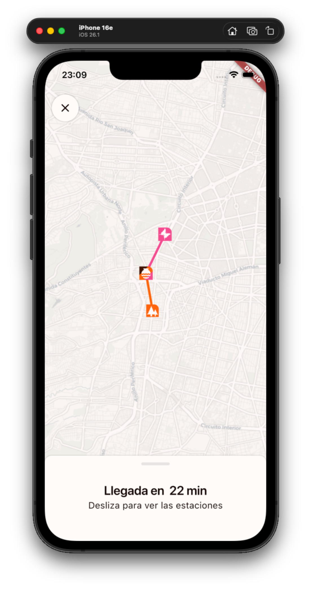

### Accessible mode

With accessible mode on, routing prioritizes accessible stations (those with elevators and ramps). Stations are also marked as accessible or not throughout the app.

    
    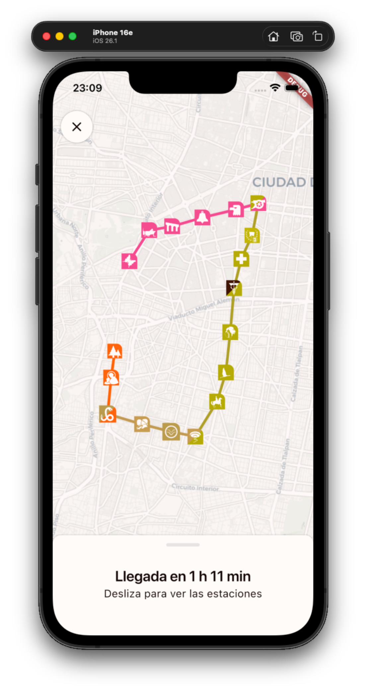

### Search lines and stations

Browse and search the whole network from the map. The search screen has two tabs which show the different **Stations** and **Lines** respectively.

    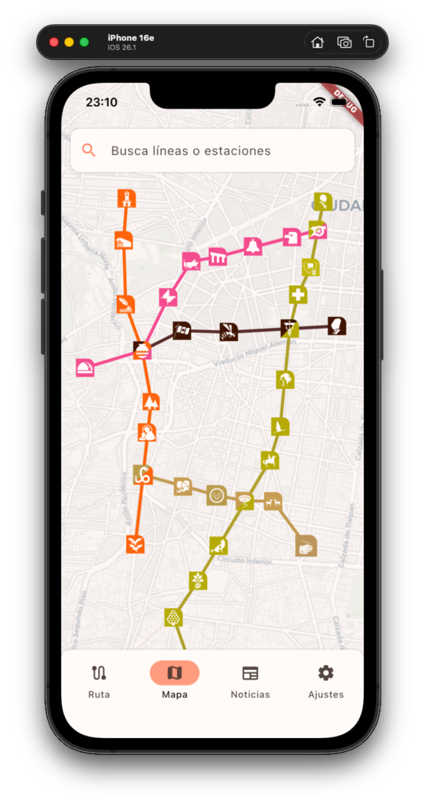
    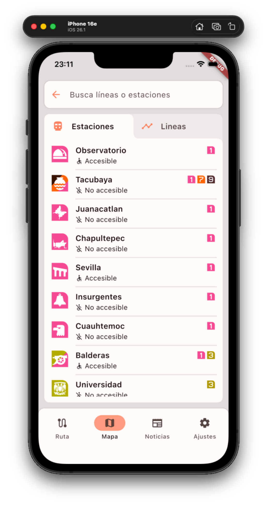
    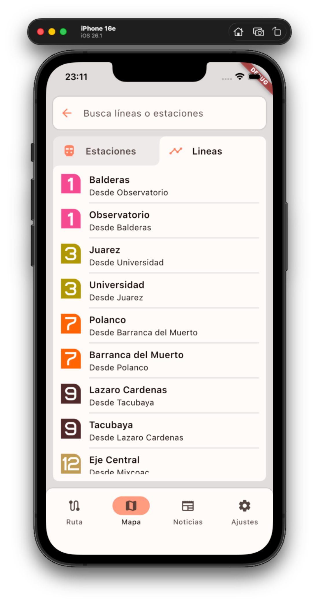

### Line and station information

Select a line to see all its stations in order, with their accessibility status and transfers. Select a station to see the estimated time left for the next three trains.

    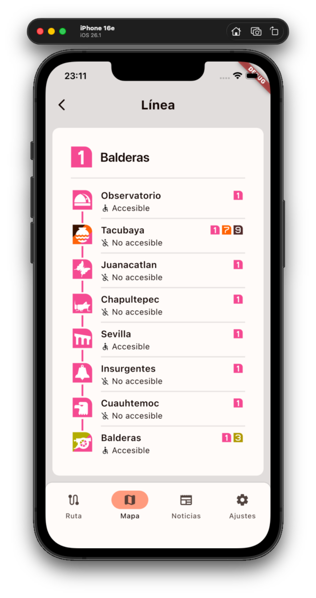
    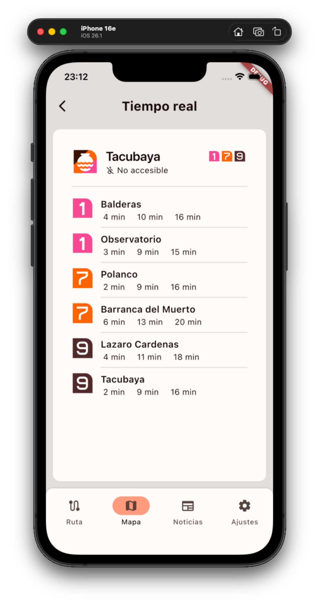

### News and notices

A dedicated section keeps you informed about works, reopenings and other relevant changes to the network. Open any article to read it in full.

    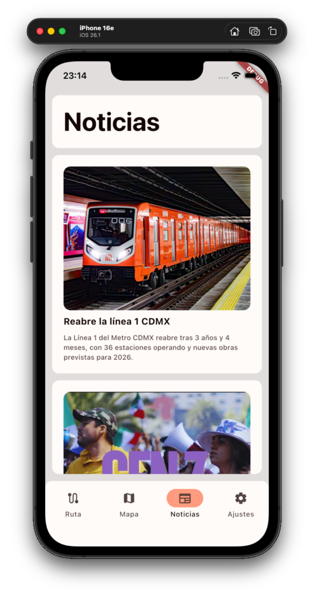
    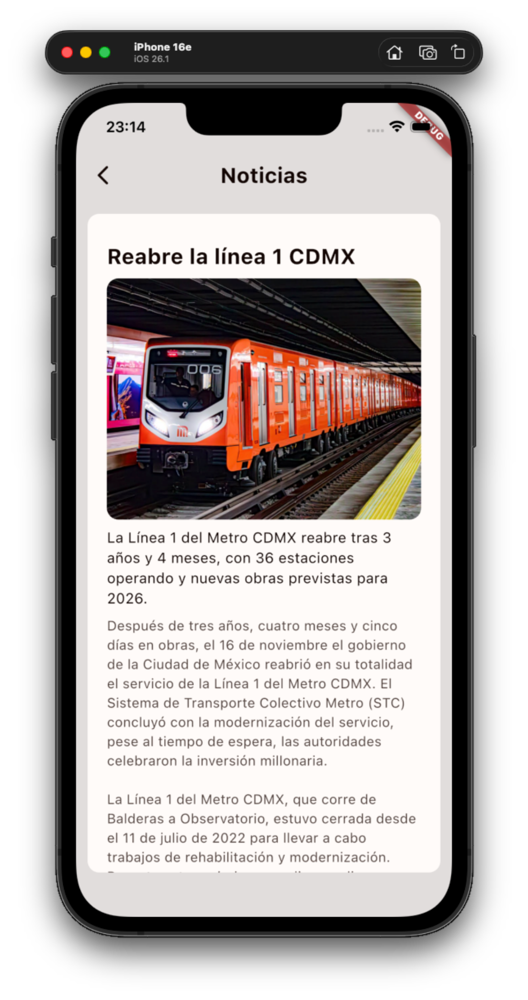

### Settings and customization

The app is fully customizable:

- **Appearance:** light or dark mode, text size and color tone.
- **Accessibility:** toggle accessible mode on or off. When on, routes prioritize accessibility; when off, they prioritize speed.
- **Storage:** clear all saved data (favorites, recents and settings) with one tap.

    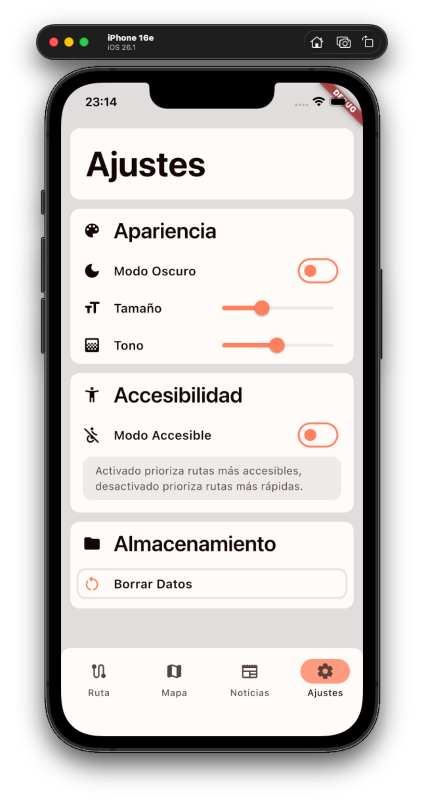
    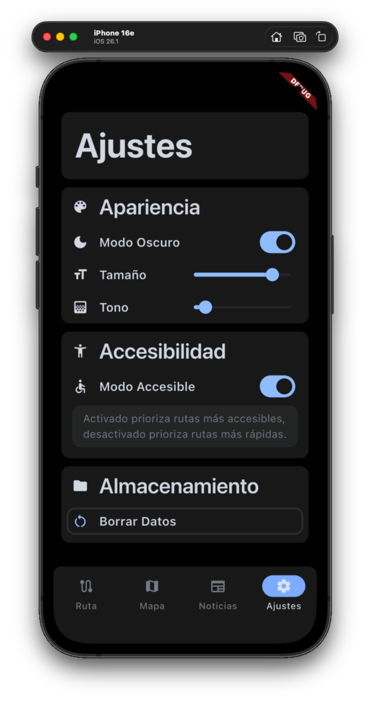

## Download and installation

### Android

1. Download the APK directly from `releases/mcdmex-android.apk`.
2. Send it to any Android device and open it to install and run it.

---

### macOS

1. Download the app zip directly from `releases/mcdmex-macOS.zip`.
2. Unzip the file and open the app to run it.
3. If macOS complains that the developer is unknown:
   - Go to **System Settings → Privacy & Security**.
   - Accept the app with **"Allow apps from…"**.

---

### Flutter

1. Clone the repository.
2. Install Flutter. [You can find the instructions here.](https://docs.flutter.dev/install/manual)
3. Open the root of the repository and run `flutter run -d <device>`.

> [!NOTE]
> macOS users can also run the app on an iPhone simulator by running `flutter run` with the *Simulator* app open. This requires *Xcode* and an *iOS* device installed in *Simulator*.
