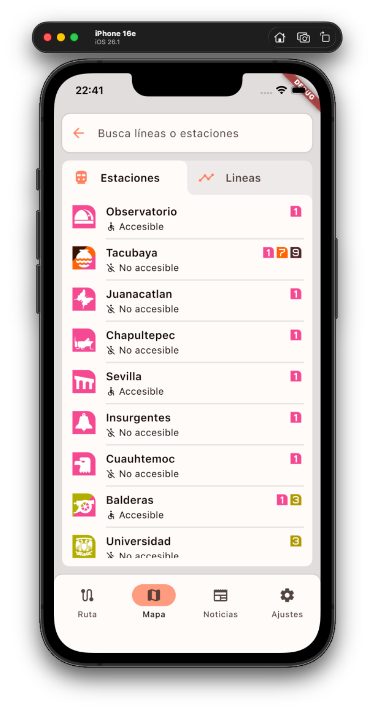
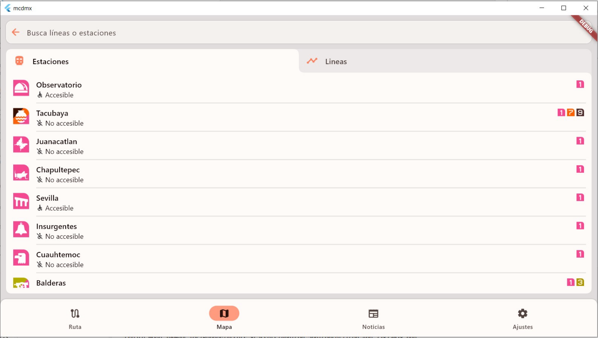
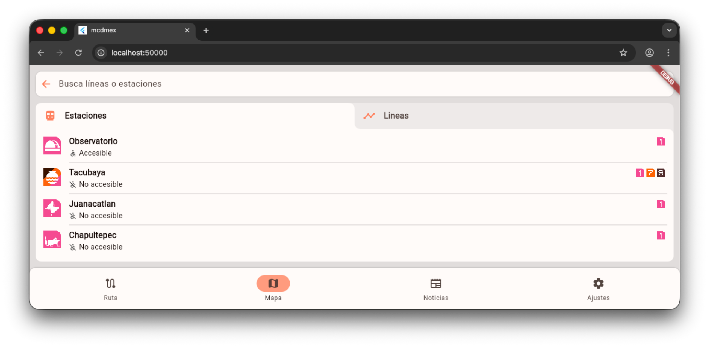

# mcdmex

A modern, accessible and fully customizable app for subway navigation in Mexico City.

<p style="display: flex; justify-content: space-between;">
    
    
</p>

## Table of contents

- [Introduction](#introduction)
- [Features](#features)
- [App tour](#app-tour)
- [Routing algorithm](#the-routing-algorithm)
- [Download and installation](#download-and-installation)

## Introduction

`mcdmex` is a navigation app for the Mexico City Metro, built around an interactive map of the network's lines, stations and transfers.

It lets you check train arrival times and plan optimal routes between stations, choosing either the **fastest** option or the **most accessible** one. It also includes a news panel that keeps you informed about works, changes and other important notices.

Thanks to Flutter, the app runs on almost any platform.

<p align="center">
    
    
    
</p>
<p align="center">
    
    
</p>

## Features

- **Interactive map** of the whole network, with every line and station.
- **Route planning** between any two stations, with step-by-step directions.
- **Two routing modes:** fastest route or most accessible route.
- **Arrival times** for every line and direction at each station.
- **Search** for lines and stations.
- **Favorites and recents** for the routes you use most.
- **News and notices** about works and service changes.
- **Customization:** light and dark themes, text size, tone and more.

## App tour

### Home and favorites

The home screen is where every trip starts. Search for a destination, or jump straight back into a route you have saved in **Favorites** or used recently in **Recents**.

<p align="center">
    
    
    
</p>

### Route planning

Open the map and tap the route panel to pick your origin and destination, either by searching for a station or selecting it directly on the map. The panel can be collapsed to leave the map visible or expanded to follow the directions: which line to take, in which direction, where to transfer, and where to get off. The estimated total travel time is always shown, and any route can be saved to your favorites.

<p align="center">
    
    
    
    
</p>

### Accessible mode

With accessible mode enabled, routing prioritizes accessible stations and connections over raw speed, so you get the route that works best for you, even if it takes longer. Stations are marked as accessible or not throughout the app.

<p align="center">
    
    
</p>

### Search lines and stations

Browse and search the whole network from the map. The search screen has two tabs: **Stations** (with the lines that serve each one and whether it is accessible) and **Lines** (with each direction of travel).

<p align="center">
    
    
    
</p>

### Line and station information

Select a line to see all its stations in order, with their accessibility status and transfers. Select a station to see the **time until the next trains** for each line and direction that serves it.

<p align="center">
    
    
</p>

### News and notices

A dedicated section keeps you informed about works, reopenings and other relevant changes to the network. Open any article to read it in full.

<p align="center">
    
    
</p>

### Settings and personalization

Make the app yours:

- **Appearance:** light or dark mode, text size and color tone.
- **Accessibility:** toggle accessible mode on or off. When on, routes prioritize accessibility; when off, they prioritize speed.
- **Storage:** clear all saved data (favorites, recents and settings) with one tap.

<p align="center">
    
</p>

## Routing algorithm

Routes are computed with an **A\*** search over a graph of the network, using a custom heuristic designed to keep the search small without sacrificing route quality.

### Model

- **Station:** a physical station, with name, coordinates and accessibility.
- **Stop:** a station *in a given direction of a given line*. These are the **nodes** of the graph.
- **Edge:** a connection between two stops. It is either a ride between consecutive stations or a transfer on foot within the same station, and carries its travel time as cost.
- Origin and destination are **stations**, so the search starts from *all* stops of the origin station and finishes at *any* stop of the destination station.

### Cost function

The cost of reaching a neighboring stop adds up:

1. **Transit time:** time on the train between stops.
2. **Transfer time:** time walking between platforms when changing lines.
3. **Waiting time:** the time until the next train arrives, calculated for the exact moment you would be there. It depends on the time of day (opening hours, peak and off-peak frequencies).

### Heuristic

```
h = p · SLT + q · TP
```

| Term | Meaning |
|------|---------|
| **SLT** (*straight-line time*) | `‖vᵢ, v*‖₂ / V_max`: straight-line distance from the current stop to the destination, divided by the maximum train speed. It is the best case if a train ran straight to the destination. |
| **TP** (*transfer penalty*) | `N_min(vᵢ, v*) · T_min`: the minimum number of transfers needed to get from the current stop to the destination, multiplied by the minimum transfer time. |
| **p, q** | Weights tuned empirically with a benchmark: `p = 1.31`, `q = 3.06`. |

Combining distance with a transfer penalty gives the search much better information than distance alone: it knows that going to a destination on another line costs time even if the station looks close on the map.

**Benchmark** (average travel time, average branching factor; the first is held fixed and the second is minimized):

| Heuristic | Avg. time | Avg. branching |
|-----------|-----------|----------------|
| Basic Euclidean (`SLT`) | 24.86 | 23.30 |
| Penalized Euclidean (`SLT + TP`) | 24.86 | 17.89 |
| Tuned (`p·SLT + q·TP`) | 24.86 | **10.33** |

The tuned heuristic reduces the average branching factor by more than half compared to the basic one, with the same average travel time.

> [!NOTE]
> Since `p` and `q` are greater than 1, the tuned heuristic is no longer guaranteed to be admissible (a strict lower bound), so A\* can no longer formally guarantee optimal routes. In the benchmark the average travel time was unchanged.

### Tie-breaking and search modes

Open set entries are ordered as a priority queue of tuples `(acc, g, h, stop)`:

1. **Accessible mode only:** compare the accessibility score first.
2. Then compare `f = g + h`; the lowest wins.
3. On a tie, prefer the lowest `h`, i.e., the stop that looks closest to the destination.
4. If it is still a tie, choose randomly.

| Mode | Result |
|------|--------|
| **Standard** | The fastest route. |
| **Accessible** | The most accessible route. |

## Download and installation

### Android

1. Download the APK directly from `releases/mcdmex-android.apk`.
2. Send it to any Android device and open it to install and run it.

---

### macOS

1. Download the app zip directly from `releases/mcdmex-macOS.zip`.
2. Unzip the file and open the app to run it.
3. If macOS complains that the developer is unknown:
   - Go to **System Settings → Privacy & Security**.
   - Accept the app with **"Allow apps from…"**.

---

### Flutter

1. Clone the repository.
2. Install Flutter. [You can find the instructions here.](https://docs.flutter.dev/install/manual)
3. Open the root of the repository and run `flutter run -d <device>`.

> [!NOTE]
> macOS users can also run the app on an iPhone simulator by running `flutter run` with the *Simulator* app open. This requires *Xcode* and an *iOS* device installed in *Simulator*.
